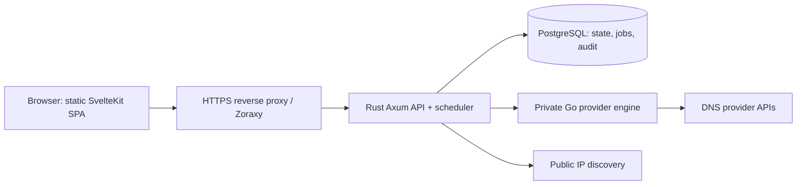

# Architecture

Status: Phase 0 baseline, 2026-11-03. Implementation status belongs in the
[roadmap](roadmap.md), [feature matrix](feature-parity.md) and task memory.
The design uses the requested Rust/Svelte/PostgreSQL stack and a separate Go
provider engine. The license is AGPL-3.0-only (user decision, 2026-11-03).

## Services and responsibilities

`ddnsupd` serves static assets and `/api/v1/`. It owns setup, authentication,
roles, resource grants, encrypted credentials, records, persistent jobs,
history and audit. The scheduler runs in the same Rust process for the first
increment. Queue and domain logic live in separate modules so a dedicated
Rust worker remains possible. It does not run a second upstream scheduler.

`ddnsupd-worker` is the Go provider engine. It receives bounded, authenticated
requests on a private container network. It has no PostgreSQL credentials,
user sessions or configuration files. Plaintext provider secrets exist only
for a single request. Its logs contain correlation IDs and classified errors.

PostgreSQL is the only durable source of truth. A transactional outbox and
`FOR UPDATE SKIP LOCKED` jobs avoid a second broker. Job state is persisted
before network work; leases, attempts and outcomes survive restarts.

## Reuse boundary

TalkOps supplies design and organizational principles: static SPA from Rust,
domain crates, PostgreSQL jobs, immutable migrations, centralized project
rules, bilingual UI, test-backed verification and a separate release role.
Telephony, host networking, SIP services and media volumes do not apply.
DDNSupd uses bridge networks and must be testable on Docker Desktop.

ddns-updater has 60 provider registry entries (59 excluding its development
example). Its implementations live in Go `internal` packages and its common
Provider interface includes HTML methods. There is no stable external
management SDK. Targeted adaptation preserves MIT notices and provenance;
the new engine contract removes UI methods. The initial adapters are
Hetzner Cloud and Cloudflare. Remaining providers stay explicitly planned.
See [ADR 0002](adr/0002-provider-engine.md).

## Update transaction and concurrency

1. Authorize a manual request or select a due active record. Enqueue one
   logical check per record. A manual check never bypasses provider cooldown.
2. Claim the job and acquire a session advisory lock for the provider's
   zone/name/type mutation unit. Hold that lock across bounded network work.
   A connection loss cancels work; a replacement worker reconciles first.
3. Reload active state and configuration version. Discover a valid public IP
   of the requested family. Discovery failure prevents provider writes.
4. Read actual provider state. Use Cloudflare origin content, not proxy DNS.
   Check zone, record identity and the previously managed value.
5. If the desired value is present, save a no-change check. Otherwise replace
   only the bound managed value, preserve siblings and reject ambiguity.
   Missing records require an explicit create operation, not silent creation.
6. Re-read provider state after the write or asynchronous action. A timeout
   after send is an uncertain outcome: reconcile before any new write.
7. Store history, next check, cooldown and job outcome atomically. Emit an
   outbox event for later notification support.

There is no exactly-once guarantee for third-party HTTP APIs. Idempotent
desired-state operations, one mutation lock and read-after-write reconciliation
limit duplicates. Locks include RRSets and shared accounts where required;
record-only locking is insufficient for Netcup and Hetzner batch changes.
See [the engine contract](provider-engine-contract.md) and test plan.

## Time and IP semantics

Default check interval is five minutes. A record override takes precedence
over provider and system defaults. Effective write time is the maximum of
the record due time, account rate limit, retry backoff and provider cooldown.
Respect `Retry-After`; authentication failures suspend until credentials
change or an explicit, rate-limited connection test succeeds.

A and AAAA are separate managed records and jobs. Upstream `ipv4 or ipv6`
means one family selected by discovery, not dual-stack. Import must make this
choice explicit. UTC timestamps are stored as `timestamptz`.

Separate public IPv4/IPv6 HTTPS sources have bounded timeouts and response
sizes. Reject private, loopback, CGNAT, link-local, multicast, documentation,
reserved and IPv4-mapped private addresses. CGNAT/DS-Lite detection is a warning
about reachability, not proof of inbound connectivity. IPv6 suffix composition
uses explicit prefix length and suffix bits. DNS discovery, source consensus,
agents and custom discovery URLs are distinct later capabilities.

## Security and deployment

Argon2id passwords; random opaque sessions stored as hashes; HttpOnly,
SameSite=Strict cookies, Secure under HTTPS; exact configured Origin and
per-session CSRF token for mutations. Role permission and resource grant must
both allow the operation. Administrator is immutable; protect the last admin.
All queries, counts, export and history use the same resource scope.

Credentials use authenticated encryption with fresh nonces, associated
provider identity and a key ID. The master key is outside the DB. Rotation
must retain old keys until re-encryption and recovery tests finish. API
responses expose credential presence only. Backups need data, configuration
and matching key material plus a separate recovery secret.

Only the web/API port is published, on loopback by default. PostgreSQL and
engine stay private. Engine requests require a separate service secret.
Containers run without privilege or capabilities and with read-only roots
where possible. No Docker socket is mounted. External HTTPS URL determines
cookie policy. Forwarded headers are ignored unless a future explicit trusted
proxy policy validates the direct peer; do not trust arbitrary X-Forwarded-For.

Custom URL providers and webhooks stay disabled until connection-time public
address validation, DNS rebinding prevention, redirect policy and redaction
tests exist. They are not equivalent to fixed, audited provider endpoints.

## API and UI

Versioned JSON API, typed errors with code and request ID, bounded pagination,
filters, audit for each mutation and generated OpenAPI. Manual updates use
POST and return a job ID (202). GET never changes DNS. Imported data stays
inactive until a user reviews and enables it.

The bounded implementation in [ADR 0008](adr/0008-read-only-discovery-and-staged-import.md)
uses private GET-only provider discovery and user-bound, expiring normalized
import drafts. Confirmation binds existing records atomically and never activates
them. Read-only access tests cannot certify DNS write permission.

The UI has setup/login, dashboard, providers, zones, records with inspector,
history and administration. Loading, empty, stale and failed states are
separate. Data refresh preserves visible content. Status distinguishes
provider acceptance, verified origin value and observed public propagation.
Do not show simulated operational data. See [UI guidelines](ui-guidelines.md).

## Data model

See [data-model.md](data-model.md). Use normal foreign keys, explicit resource
grants, partial job uniqueness, append-only audit and forward-only migrations.
The first deployment is one installation, with multiple users, providers and
sites. Multi-tenant SaaS is out of scope; adding it needs an ADR.

## Acceptance and release

A fresh Docker host must run the released, versioned Compose stack without a
source build. Until publication is explicitly authorized, source builds and
mock tests validate development only; an unpublished GHCR image is not an
installation artifact. Release gates include recovery, browser, security and
provider tests. A live integration is verified only against a user-authorized
test zone with its exact adapter version recorded.
